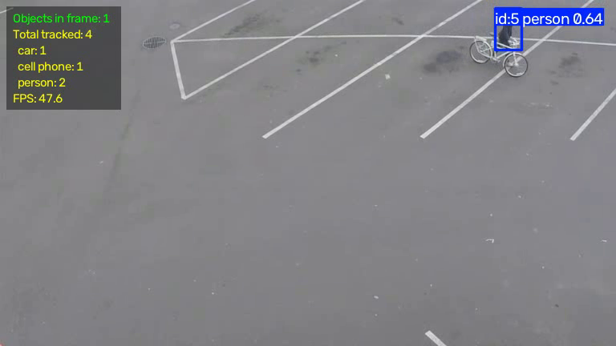

# CodeAlpha — Détection et suivi d'objets

Détection, suivi et comptage d'objets en temps réel avec **YOLO (Ultralytics)** et **OpenCV**.


**Démo en ligne : [detection-suivi-objets.onrender.com](https://detection-suivi-objets.onrender.com)** — image et
courte vidéo (15 s) dans le navigateur. Hébergement gratuit : le premier chargement peut prendre environ une minute,
et le traitement d'une vidéo une à deux minutes. La démo est une version allégée (YOLO11n en ONNX et un ByteTrack
en NumPy, sans PyTorch), voir [`demo/`](demo/).

Projet réalisé pour la **tâche 4 — Object Detection and Tracking** du stage d'intelligence artificielle CodeAlpha.

| Exigence de la tâche | Mise en œuvre |
| --- | --- |
| Entrée vidéo en temps réel (webcam ou fichier) | `--source 0` (webcam), un fichier vidéo, une image ou l'URL d'un flux, lus avec OpenCV |
| Modèle de détection pré-entraîné | YOLO11n pré-entraîné sur COCO (80 classes), poids téléchargés automatiquement |
| Traiter chaque image et tracer les boîtes | chaque image passe par YOLO ; les boîtes, les classes et les scores de confiance sont dessinés |
| Suivi d'objets (famille SORT) | ByteTrack par défaut (`--tracker bytetrack.yaml`), BoT-SORT disponible |
| Afficher les libellés et les identifiants de suivi en temps réel | fenêtre OpenCV avec identifiants, comptages par classe et FPS ; export vidéo annoté en option |

## Démo




*Images tirées de `person-bicycle-car-detection.mp4` — [vidéos d'exemple Intel IoT DevKit](https://github.com/intel-iot-devkit/sample-videos), CC BY 4.0.
CPU uniquement, vidéo 768×432 : environ 45–50 FPS avec YOLO11n.*

## Installation

```bash
git clone https://github.com/bienvenuessegnon/CodeAlpha_Object_Detection.git
cd CodeAlpha_Object_Detection
python -m venv .venv
source .venv/bin/activate          # Windows: .venv\Scripts\activate
pip install -r requirements.txt
```

`lap` est listé explicitement : les suiveurs Ultralytics en ont besoin (sinon Ultralytics tente de l'installer à l'exécution).

## Utilisation

```bash
python object_detection.py                                   # webcam par défaut (Q pour quitter)
python object_detection.py --source video.mp4                # fichier vidéo
python object_detection.py --source video.mp4 --save output/result.mp4
python object_detection.py --source video.mp4 --no-show --save output/result.mp4   # sans affichage (serveur, Colab)
python object_detection.py --source image.jpg --save output/image.jpg              # image seule (sans suivi)
python object_detection.py --source 0 --classes person car --conf 0.4              # filtrer les classes
```

| Option | Défaut | Description |
| --- | --- | --- |
| `--source` | `0` | index de la webcam, fichier vidéo, image ou URL de flux |
| `--model` | `yolo11n.pt` | poids YOLO (`yolo11s.pt`, `yolo11m.pt`… plus précis mais plus lents) |
| `--conf` | `0.5` | seuil de confiance |
| `--tracker` | `bytetrack.yaml` | `bytetrack.yaml` ou `botsort.yaml` |
| `--classes` | toutes | ne garder que ces classes COCO |
| `--save` | — | écrire la vidéo ou l'image annotée |
| `--no-show` | désactivé | pas de fenêtre (utile sans affichage) |
| `--max-frames` | `0` | s'arrêter après N images (0 = vidéo entière) |

## Fonctionnement

```
Webcam / vidéo ──► OpenCV (lecture de l'image) ──► YOLO11 (détection) ──► ByteTrack (identifiants d'une image à l'autre)
               ──► comptage (image + identifiants uniques par classe) ──► affichage annoté / fichier vidéo
```

- **Objects in frame** : nombre de détections dans l'image courante.
- **Total tracked** : nombre d'identifiants de suivi uniques vus pendant la session, aussi affiché par classe.
  Lorsqu'un objet est perdu (occlusion, faible confiance) puis retrouvé, le suiveur peut lui donner un nouvel identifiant,
  ce total est donc une borne supérieure du nombre réel d'objets.

## Tests

```bash
pip install -r requirements-dev.txt
pytest -q
```

Les tests s'appuient sur un petit modèle factice : ils vérifient l'analyse de la source, le filtre de classes, la logique de comptage,
l'incrustation et l'appel au suivi, sans télécharger les poids YOLO.

## Structure du projet

```
CodeAlpha_Object_Detection/
├── object_detection.py     # CLI : détection, suivi, comptage, affichage / export
├── requirements.txt
├── requirements-dev.txt    # + pytest
├── tests/
│   └── test_object_detection.py
├── docs/                   # images de la démo
└── demo/                   # démo en ligne allégée (ONNX + ByteTrack, Gradio)
```

## Limites et pistes

- Les modèles COCO peinent sur des points de vue inhabituels (par exemple, des voitures vues à la verticale sont parfois manquées).
- Les changements d'identifiant gonflent le comptage unique ; un comptage par franchissement de ligne ou par zone donnerait des totaux plus robustes.
- Suites possibles : comptage par ligne ou zone, une petite interface Streamlit ou Gradio, un modèle entraîné sur un jeu spécifique.

## Auteur

**Bienvenu ESSEGNON** — [GitHub @bienvenuessegnon](https://github.com/bienvenuessegnon) ·
[LinkedIn](https://www.linkedin.com/in/bienvenuessegnon)

Réalisé dans le cadre du stage d'intelligence artificielle CodeAlpha. Les modèles YOLO et la bibliothèque Ultralytics sont
distribués sous licence AGPL-3.0.
