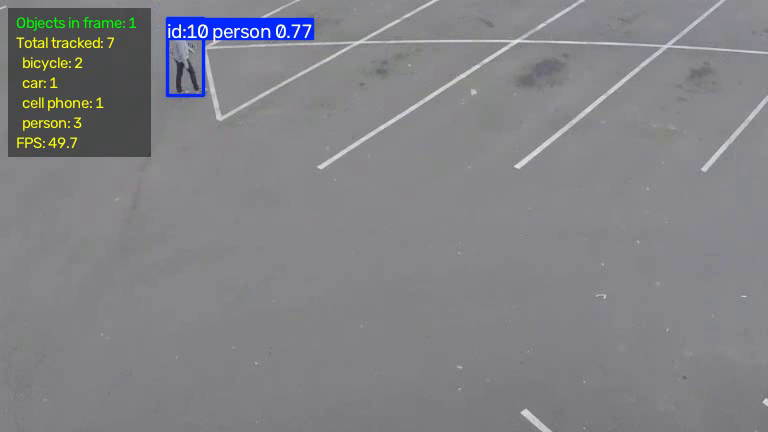

# 👁️ CodeAlpha — Object Detection and Tracking

Real-time object detection, tracking and counting with **YOLO (Ultralytics)** and **OpenCV**.


**Démo en ligne : [detection-suivi-objets.onrender.com](https://detection-suivi-objets.onrender.com)** — image and
short video (15 s) in the browser. Free hosting: the first load can take about a minute and video processing takes
one to two minutes. The demo is a lightweight version (YOLO11n in ONNX + a NumPy ByteTrack, no PyTorch), see
[`demo/`](demo/).

Project developed for **Task 4 — Object Detection and Tracking** of the CodeAlpha Artificial Intelligence Internship.

| Task requirement | Implementation |
| --- | --- |
| Real-time video input (webcam or video file) | `--source 0` (webcam), a video file, an image or a stream URL, read with OpenCV |
| Pre-trained object detection model | YOLO11n pre-trained on COCO (80 classes), weights downloaded automatically |
| Process each frame and draw bounding boxes | every frame goes through YOLO; boxes, class labels and confidence scores are drawn |
| Object tracking (SORT family) | ByteTrack by default (`--tracker bytetrack.yaml`), BoT-SORT available |
| Display labels and tracking IDs in real time | OpenCV window with IDs, counts per class and FPS; optional annotated video output |

## Demo




*Frames from `person-bicycle-car-detection.mp4` — [Intel IoT DevKit sample videos](https://github.com/intel-iot-devkit/sample-videos), CC BY 4.0.
CPU only, 768×432 video: about 45–50 FPS with YOLO11n.*

## Installation

```bash
git clone https://github.com/bienvenuessegnon/CodeAlpha_Object_Detection.git
cd CodeAlpha_Object_Detection
python -m venv .venv
source .venv/bin/activate          # Windows: .venv\Scripts\activate
pip install -r requirements.txt
```

`lap` is listed explicitly: the Ultralytics trackers need it (otherwise Ultralytics tries to install it at run time).

## Usage

```bash
python object_detection.py                                   # default webcam (press Q to quit)
python object_detection.py --source video.mp4                # video file
python object_detection.py --source video.mp4 --save output/result.mp4
python object_detection.py --source video.mp4 --no-show --save output/result.mp4   # headless (server, Colab)
python object_detection.py --source image.jpg --save output/image.jpg              # single image (no tracking)
python object_detection.py --source 0 --classes person car --conf 0.4              # filter classes
```

| Option | Default | Description |
| --- | --- | --- |
| `--source` | `0` | webcam index, video file, image or stream URL |
| `--model` | `yolo11n.pt` | YOLO weights (`yolo11s.pt`, `yolo11m.pt`… are more accurate but slower) |
| `--conf` | `0.5` | confidence threshold |
| `--tracker` | `bytetrack.yaml` | `bytetrack.yaml` or `botsort.yaml` |
| `--classes` | all | keep only these COCO class names |
| `--save` | — | write the annotated video or image |
| `--no-show` | off | no window (useful without a display) |
| `--max-frames` | `0` | stop after N frames (0 = whole video) |

## How it works

```
Webcam / video ──► OpenCV (read frame) ──► YOLO11 (detection) ──► ByteTrack (IDs across frames)
               ──► counting (frame + unique IDs per class) ──► annotated display / video file
```

- **Objects in frame**: number of detections in the current frame.
- **Total tracked**: number of unique tracking IDs seen during the session, also shown per class.
  When an object is lost (occlusion, low confidence) and found again, the tracker can give it a new ID,
  so this total is an upper bound of the real number of objects.

## Tests

```bash
pip install -r requirements-dev.txt
pytest -q
```

The tests use a small fake model: they check the source parsing, the class filter, the counting logic,
the overlay and the tracking call without downloading YOLO weights.

## Project structure

```
CodeAlpha_Object_Detection/
├── object_detection.py     # CLI: detection, tracking, counting, display / export
├── requirements.txt
├── requirements-dev.txt    # + pytest
├── tests/
│   └── test_object_detection.py
├── docs/                   # demo frames
└── demo/                   # lightweight online demo (ONNX + ByteTrack, Gradio)
```

## Limitations and ideas

- COCO models struggle with unusual viewpoints (e.g. cars seen from directly above are sometimes missed).
- ID switches inflate the unique count; line-crossing or zone counting would give more robust totals.
- Possible next steps: line/zone counting, a small Streamlit or Gradio interface, a custom-trained model.

## Author

**Bienvenu ESSEGNON** — [GitHub @bienvenuessegnon](https://github.com/bienvenuessegnon) ·
[LinkedIn](https://www.linkedin.com/in/bienvenuessegnon)

Developed for the CodeAlpha Artificial Intelligence Internship. YOLO models and the Ultralytics library are
distributed under the AGPL-3.0 license.
